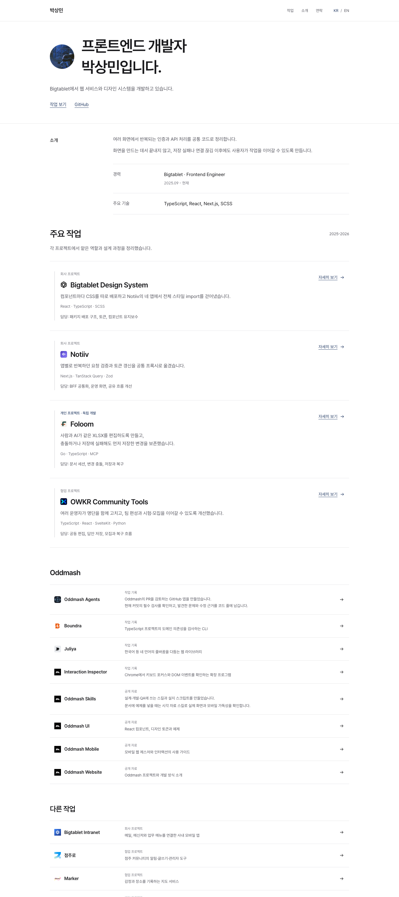

# Park Sangmin

제품 화면과 공통 UI를 만드는 프론트엔드 개발자 박상민의 포트폴리오입니다.

[포트폴리오](https://park-sangmin.vercel.app/) · [English](https://park-sangmin.vercel.app/en/) · [GitHub](https://github.com/qtaghdi)

[](https://park-sangmin.vercel.app/)

## 포트폴리오 구성

- **대표 프로젝트**에는 Bigtablet Design System, Notiiv, Foloom, OWKR Community Tools에서 맡은 역할과 설계 과정을 담았습니다.
- **Oddmash**에는 [Oddmash Agents 사례](https://park-sangmin.vercel.app/projects/oddmash-agents/)와 Skills, UI 등 공개 자료를 모았습니다.
- **다른 작업**에는 Kowrap에서 시작해 네 언어의 줄바꿈을 지원하는 [Juliya](https://park-sangmin.vercel.app/projects/juliya/)와 TypeScript 도메인 경계를 검사하는 [Boundra](https://park-sangmin.vercel.app/projects/boundra/) 등이 있습니다. Echo와 Chorus는 ‘이전 작업 더 보기’에서 열 수 있습니다.
- **글과 커뮤니티**에서는 직접 조작해 볼 수 있는 예제를 담은 기술 블로그 [여백](https://qtaghdi.github.io/yeobaek/)과 Velog 글을 소개합니다.

## 개발

```sh
pnpm install
pnpm dev
```

Astro, TypeScript와 SCSS로 구성한 정적 사이트입니다. GitHub 공개 프로필은 빌드 시 한 번 조회하며, 연결 실패 시 기본 프로필을 사용합니다.

한국어 홈과 프로젝트 본문의 줄바꿈에는 `@oddmash/juliya` v0.4.3을 사용합니다.

## 이미지 갱신

```sh
pnpm assets:refresh
```

현재 화면으로 README 이미지를 촬영하고, 국문·영문 메인 및 프로젝트별 공유 카드를 생성합니다. 공유 이미지는 1200 × 630 PNG이며, 명령 실행 전 Playwright의 Chromium 또는 Chrome이 설치되어 있어야 합니다.
