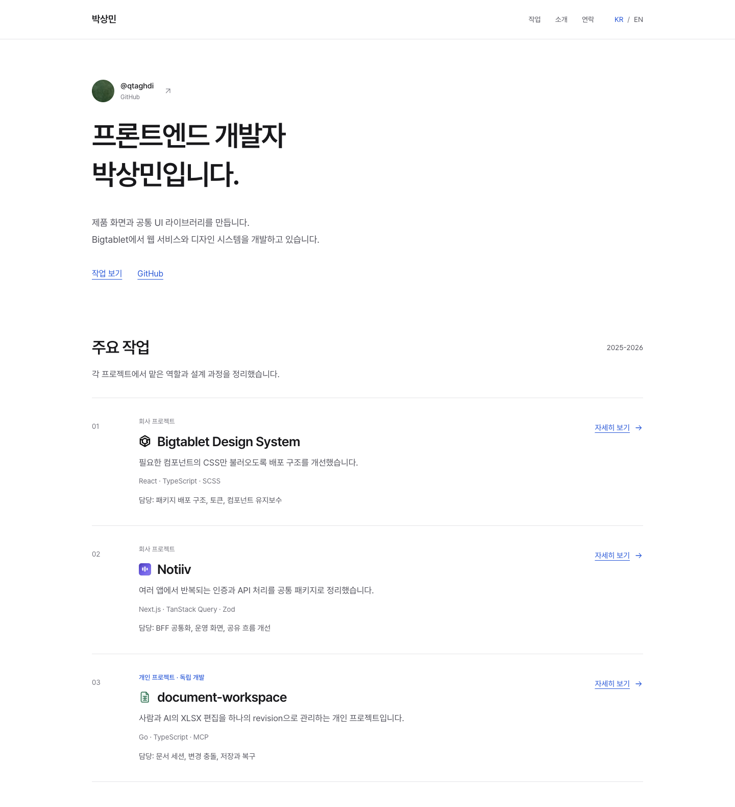

# Park Sangmin

제품 화면과 공통 UI를 만드는 프론트엔드 개발자 박상민의 포트폴리오입니다.

[포트폴리오](https://park-sangmin.vercel.app/) · [English](https://park-sangmin.vercel.app/en/) · [GitHub](https://github.com/qtaghdi)

[](https://park-sangmin.vercel.app/)

## 개발

```sh
pnpm install
pnpm dev
```

Astro, TypeScript와 SCSS로 구성한 정적 사이트입니다. GitHub 공개 프로필은 빌드 시 한 번 조회하며, 연결 실패 시 기본 프로필을 사용합니다.

## 이미지 갱신

```sh
pnpm assets:refresh
```

현재 화면으로 README 이미지를 촬영하고, 국문·영문 메인 및 프로젝트별 공유 카드 28개를 생성합니다. 공유 이미지는 1200 × 630 PNG이며, 명령 실행 전 Playwright의 Chromium 또는 Chrome이 설치되어 있어야 합니다.
